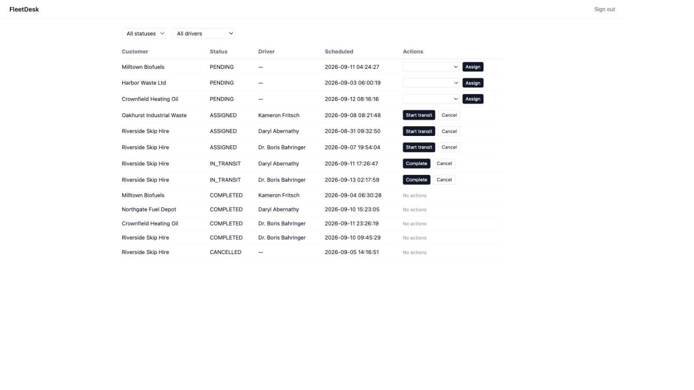
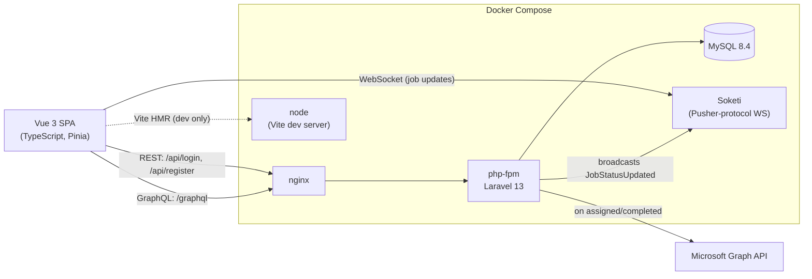

<p align="center"><strong>FleetDesk</strong></p>
<p align="center">Delivery/job management for a fuel &amp; waste logistics operation</p>

<p align="center">
<a href="https://github.com/NosakhareOsaro/fleetdesk/actions/workflows/ci.yml"></a>
</p>



## What this is

Dispatchers create delivery jobs, assign drivers, and move them through a
lifecycle (`pending → assigned → in_transit → completed`, with `cancelled`
reachable from any non-terminal state). Every status change broadcasts live
to the dashboard over WebSockets, and assigning or completing a job syncs a
Microsoft 365 calendar event.

It's a portfolio project built to demonstrate PHP 8.4/Laravel 13, GraphQL
(Lighthouse), Vue 3 + TypeScript, MySQL, PHPUnit/TDD, Docker, GitHub Actions
CI, Soketi/WebSockets, and Microsoft Graph integration.

## Architecture



## Where each requirement is demonstrated

| Area | Where |
|---|---|
| Laravel 13, PHP 8.4 | `app/`, `composer.json` |
| Sanctum auth (REST) | `app/Http/Controllers/AuthController.php`, `routes/api.php` |
| GraphQL API (Lighthouse) | `graphql/schema.graphql`, `app/GraphQL/Mutations/` |
| Vue 3 + TypeScript (strict) | `resources/js/`, `tsconfig.json` |
| Typed GraphQL client (codegen) | `codegen.ts`, `resources/js/generated/` |
| MySQL + migrations | `database/migrations/` |
| PHPUnit, TDD-first | `tests/Feature/` — see commit history: every feature is a failing-test commit followed by an implementation commit |
| Docker Compose | `docker-compose.yml`, `docker/` |
| GitHub Actions CI | `.github/workflows/ci.yml` (Pint, PHPUnit, ESLint, type-check, build) |
| Realtime broadcasting (Soketi) | `app/Events/JobStatusUpdated.php`, `resources/js/lib/echo.ts` |
| Microsoft Graph calendar sync | `app/Services/Graph/`, `app/Listeners/SyncJobToCalendar.php` |

## Running it

Requires Docker.

```bash
git clone https://github.com/NosakhareOsaro/fleetdesk.git
cd fleetdesk
cp .env.example .env
docker compose up -d
docker compose exec app php artisan demo:seed
```

Then open **http://localhost:8000** and log in with
`dispatcher@fleetdesk.test` / `password`.

- App: http://localhost:8000
- GraphQL endpoint: http://localhost:8000/graphql
- Vite dev server: http://localhost:5183
- Soketi: ws://localhost:6001

To see the realtime update live, open the job board in two browser tabs,
sign in on both, and change a job's status in one — the other updates
without a refresh.

## Testing

```bash
docker compose exec app php artisan test    # PHPUnit
docker compose exec app vendor/bin/pint     # PHP style
docker compose exec node npm run lint       # ESLint
docker compose exec node npm run type-check # vue-tsc
docker compose exec node npm run build      # production build
```

## Microsoft Graph setup (optional)

Calendar sync no-ops until real Azure credentials are configured — the app
works fully without it. To enable it, register an app in Azure AD with
`Calendars.ReadWrite` application permissions and set in `.env`:

```
MS_GRAPH_TENANT_ID=
MS_GRAPH_CLIENT_ID=
MS_GRAPH_CLIENT_SECRET=
MS_GRAPH_CALENDAR_USER_ID=   # the mailbox to create events in
```

## Domain model

Four models, deliberately kept small: `User` (role: dispatcher/driver/manager),
`Customer`, `Driver`, `Job`. `Job`'s table is `delivery_jobs` — Laravel's
database queue driver already owns a `jobs` table.

## Built with Claude Code

This repo was built end-to-end with [Claude Code](https://claude.com/claude-code)
working from a build brief (`CLAUDE.md`) that specified the stack, domain
model, and a phased build order (scaffold → domain/TDD → GraphQL → frontend
→ realtime → Graph integration → polish). Each phase was implemented as a
sequence of small, conventional commits — tests committed red, then the
implementation that turns them green — and verified against the running
Docker stack (including two real bugs found only by exercising the app in a
browser: a Lighthouse query-cache serialization issue, and calendar sync
exceptions breaking job updates when Graph credentials aren't configured).
